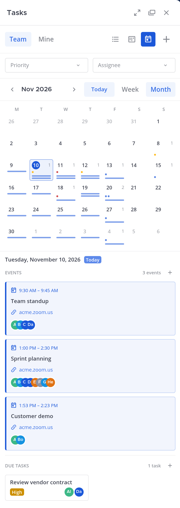
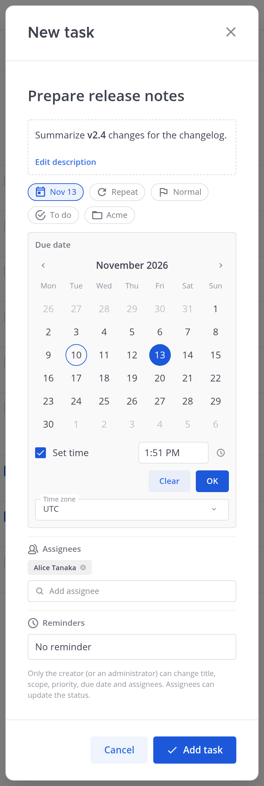
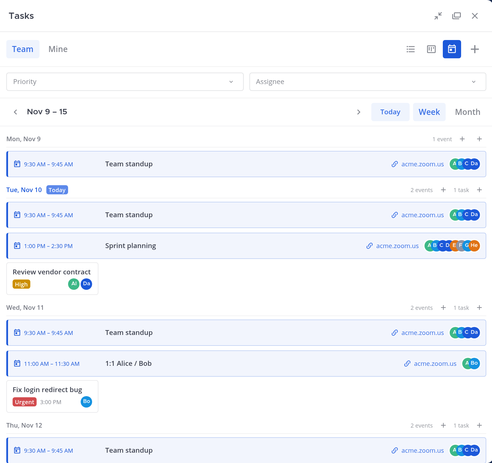
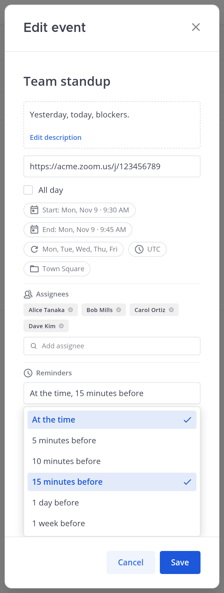
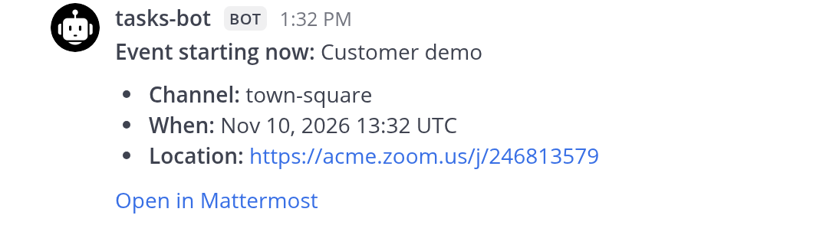

# Tasks for Mattermost

Tasks and a calendar that live inside Mattermost teams, channels and posts. No separate accounts, no
external service, no second database.

**Mattermost 11.7+** · Go server · React/TypeScript webapp

[Features](#features) · [Install](#install) · [Usage](#usage) · [Permissions](#permissions) · [Development](#development)

<p align="center">
  
</p>

## Features

- **Tasks:** list, board (drag between Todo / In progress / Done) and calendar views; manual
  ordering; priorities; Markdown descriptions; filters and sorting.
- **Events:** calendar appointments, separate from tasks (no checkbox or priority). Timed or all-day,
  with participants, an optional **location** (a Zoom/Meet URL becomes a link on the card) and a
  time zone.
- **Repeating:** daily, weekly (chosen weekdays), monthly, yearly or custom, with an optional end
  date. Completing a repeating task moves it to its next date.
- **Reminders:** a direct message from the plugin bot before a task's due time or an event's start;
  pick any of *at the time, 5 / 10 / 15 minutes, 1 day, 1 week* before.
- **Visibility:** *Only me*, *Team* or *Channel*; the server re-checks it on every request.
- **Quick capture:** **Create task** on any post, quick add in each board column, assignee
  autocomplete, assignment notifications, and `/task` slash commands.

<div align="center">

| Calendar (month) | List |
| --- | --- |
|  |  |

</div>

## Install

1. Download `com.github.3tty0n.mattermost-tasks-*.tar.gz` from a release.
2. In **System Console → Plugins → Plugin Management**, upload it and enable **Tasks**.

Requires Mattermost 11.7.0+ (web or desktop; mobile does not load plugin UIs, use `/task` there).
Release bundles are linux-amd64; maintainers can publish a macOS-inclusive one with
`gh workflow run release.yml --ref main -f macos=true`. Everything is stored in the plugin KV store.

**Settings** (System Console → Plugins → Tasks):

| Setting | Default | Meaning |
| --- | --- | --- |
| Send task assignment notifications | on | The bot DMs users newly assigned to a task |
| Default event duration (minutes) | 60 | Length of a new event, and the end time set when you pick a start (5–1440) |

## Usage

Click the check-circle icon in the channel header to open the sidebar.

- **Team / Mine:** *Team* (default in channels) shows the team's tasks and events you can read plus
  your *Only me* items. *Mine* (default in DMs) shows tasks assigned to you and events you created
  or are in.
- **Views:** List, Board and Calendar. Board and calendar load up to 100 items; narrow the filters
  for more.

### Tasks

- Create from the sidebar, from a board column's **+** (name only), or from a post's **⋯ → Create
  task** (prefilled with the post; on your own DM message it creates an *Only me* task).
- Click a card to open it. Name and description show as a preview; click to edit, click outside to
  save (**Esc** cancels). Visibility, team, channel, assignees, due date and status are editable inline.
- **Due date:** pick a day and press **OK**. Turn on **Set time** only if you need one; timed
  items keep an IANA time zone, and everyone sees the resulting instant in their own zone.
- **Repeat** and **Reminders** appear once a due date is set.

<p align="center">
  
</p>

### Calendar and events

- Month view shows dots and bars per day with the selected day's agenda below; Week view lists every
  day. Arrow keys move between days. Repeating items appear on every occurrence.
- The agenda has **+** buttons in its **Events** and **Due tasks** sections (and each week day has
  both): the first adds an event on that day, the second a task due that day. Double-clicking a day
  also opens **New event**.
- A new event starts **now** and lasts the default duration; picking a start moves the end to
  start + that duration. Start and end come from a calendar and clock picker.
- Event cards show the time range, title, location (links open in a new tab) and up to nine
  overlapped participant avatars (more become “…”; hover for all names). On narrow sidebars the
  participants move to their own row so the time range is never cut off.
- Click an event to open a read-only view; the creator or an administrator can press **Edit** (and
  delete it there). The view can copy the event to **Google Calendar** or **Outlook** (a prefilled
  new-event page opens) or download an **.ics** file for any calendar app.

<p align="center">
  
</p>

<p align="center">
  
</p>

### Reminders

Set **Reminders** on a task (with a due date) or an event. At each chosen offset the plugin bot sends
a DM to the assignees, or to the creator if nobody is assigned; Mattermost then notifies per each
user's own settings. Repeating events remind for every occurrence.

<p align="center">
  
</p>

Notes: reminders are sent once, checked every minute, and catch up at most 24 hours after downtime.
Date-only due dates and all-day events count from UTC midnight.

### Slash commands

```text
/task list
/task show <id>
/task create <title>
/task done <id>
```

## Permissions

| Operation | Who |
| --- | --- |
| View | Private: creator only. Team: team members. Channel: channel members |
| Create | Anyone who can read the scope (post tasks need channel read access) |
| Edit | Creator or system administrator, with current scope access |
| Change status | Creator, assignee or administrator |
| Delete | Creator or administrator |

Private items are visible only to their creator, even to administrators. Assignment never grants
access to a private channel, and hiding UI is not a permission check: the server enforces every rule.
The plugin makes no outbound requests.

## Development

Requires Go 1.26+, Node.js 22+ and Docker (integration tests).

```bash
make apply                          # generate manifests from plugin.json
make test                           # server + webapp tests and the bundle
SKIP_DOCKER_TESTS=1 go test ./server/...
cd webapp && npx jest --runInBand
```

The bundle is written to `dist/com.github.3tty0n.mattermost-tasks-<version>.tar.gz`.

**Storage:** full records `task:<id>` / `event:<id>`; compact, four-shard indexes per team, channel
and user; no full KV scans. Reminders are queued in per-hour buckets (`reminder:<hour>`) and fired
by a once-a-minute cluster job.

See [docs/ARCHITECTURE.md](docs/ARCHITECTURE.md), [docs/API.md](docs/API.md) and
[docs/DEPLOYMENT.md](docs/DEPLOYMENT.md). Bookmarks is a separate plugin:
[mattermost-bookmarks](https://github.com/3tty0n/mattermost-bookmarks).
