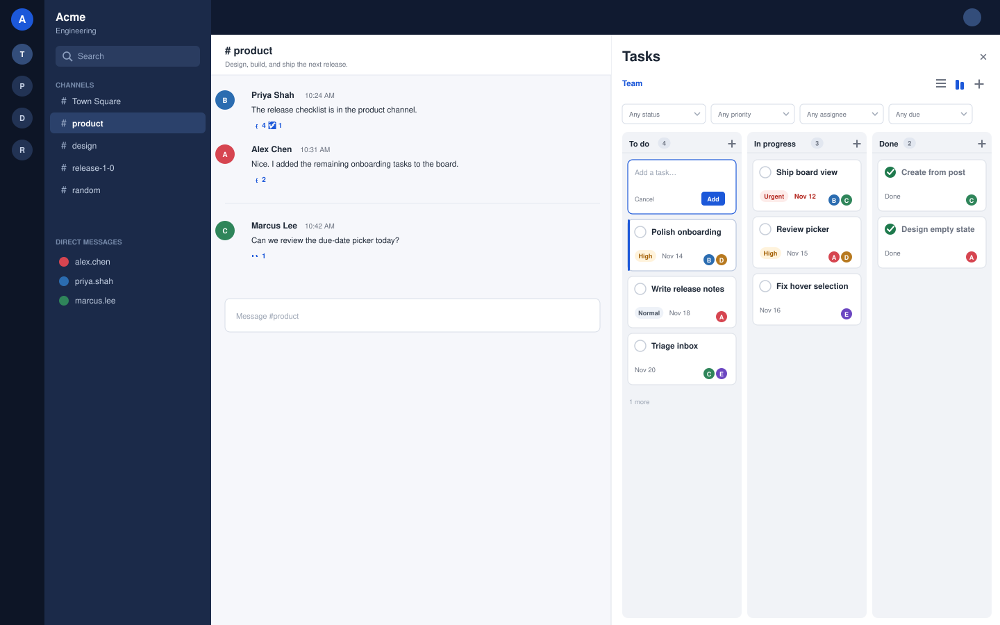
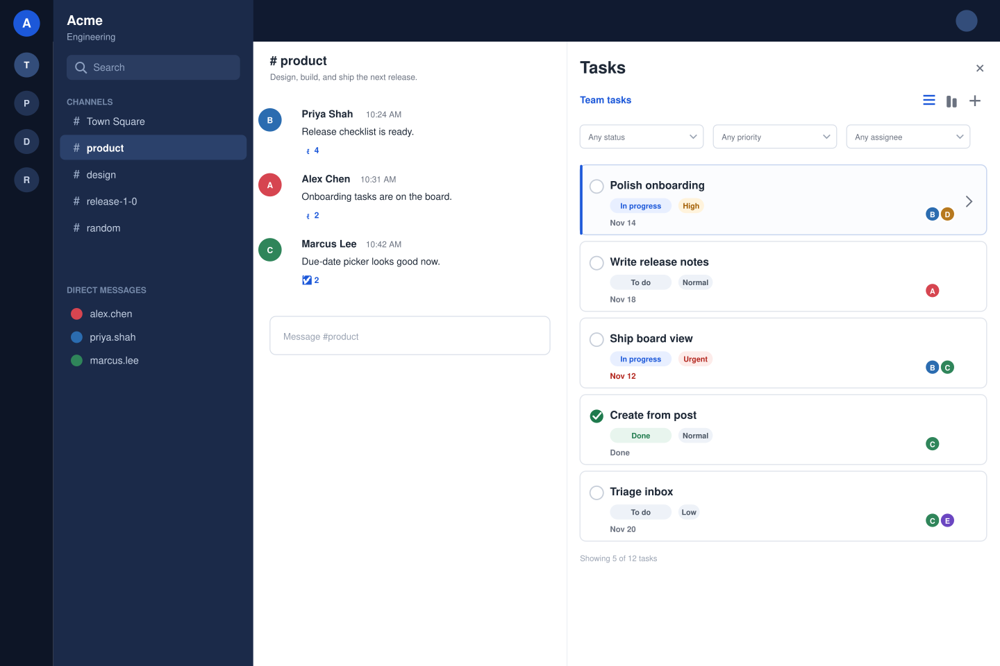
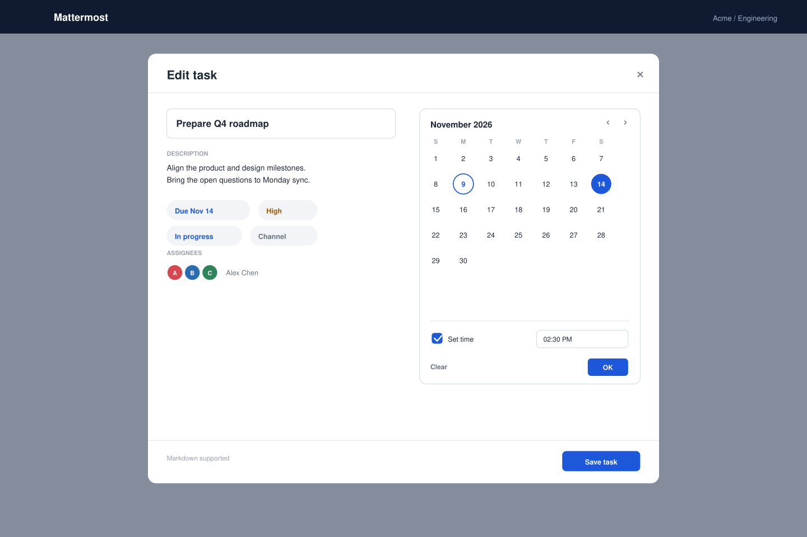

# Tasks for Mattermost

Todoist-style tasks that live inside Mattermost teams, channels and posts. No separate identity
system, no external service, no second database.

**Mattermost 11.7+** · Go server · React/TypeScript webapp

[Features](#features) · [UI previews](#ui-previews) · [Install](#install) · [Usage](#usage) · [Permissions](#permissions) · [Development](#development)



<sub>UI preview (illustrative mockup): list/board views in the channel right-hand sidebar.</sub>

## Features

| Plan and see work | Capture it quickly |
| --- | --- |
| Team / My tasks switch, context-aware default | Create from any public/private channel post |
| Private, team-wide or channel-only visibility | Name-only quick add in each board column |
| List, board and calendar views | Assignment autocomplete with avatars and usernames |
| Drag-and-drop manual ordering | Position persisted across reloads |
| Todo / In progress / Done with drag-and-drop | Assignment notifications from a plugin bot |
| Filters, sorting and pagination | `/task` slash commands for keyboard and mobile |
| Markdown descriptions and source backlinks | Click-to-edit name and description |
| Repeating tasks: daily, weekly, monthly, yearly or custom | Optional end date or endless series |

**Due dates the way you expect:** a date is date-only by default. Open the calendar, choose a day,
and press **OK**. Enable **Set time** only when you need a time. Set **Repeat** to daily, weekly,
monthly, yearly or a custom interval; choose when the series ends, or leave it endless. Completing
a repeating task moves it to its next occurrence.

**Team and My tasks in one sidebar:** switch between them at the top. The sidebar opens on
**Team** in a channel and **My tasks** in a DM. **Team** shows the current team's tasks plus your own
**Only me** tasks; **My tasks** collects everything assigned to you, with each task's team or
channel shown. New tasks default to **Team** in channels and **Only me** in DMs; you can also
choose **Only me** explicitly in the editor.
Private-channel tasks are filtered from lists and return 404 to non-members. Every route re-checks
this on the server, and the plugin never fetches URLs or stores data outside the plugin KV store.

## UI previews

### Board view

Drag cards between Todo, In progress and Done (shown in the hero image above). Each column has a
**+** for GitHub-Projects-style quick capture; card names are headlines and clicking a card opens
the inline name/description editor.

### List view

Hover a card to highlight it, then click anywhere on the card to open the inline editor. Checkboxes,
status pills and filters keep routine updates to one click.



### Due date

The calendar commits only when you press **OK**. **Clear** removes the due date. Time is optional:
leave **Set time** off for a date-only due date.



<sub>UI previews are generated illustrative mockups, not screenshots of a running server. The
generator is in [`docs/images/generate_mockups.py`](docs/images/generate_mockups.py).</sub>

## Install

1. Download `com.github.3tty0n.mattermost-tasks-*.tar.gz` from a release.
2. In Mattermost, open **System Console → Plugins → Plugin Management**.
3. Upload the bundle and enable **Tasks**.
4. Optional: disable assignment notifications in the plugin settings.

Release bundles are built for **linux-amd64** only. This keeps the download small (about 8 MB);
build from source for another server OS or architecture.

The plugin has no external service or separate database. Task data lives in the Mattermost
database's plugin KV store.

**Requirements:** Mattermost 11.7.0+ (web or desktop client). Mobile clients do not load plugin
webapps; use the `/task` slash command there.

## Usage

### Tasks sidebar

Click the check-circle icon in the channel header to open the Tasks sidebar.

- **Team / My tasks:** switch scopes with the tabs at the top. A channel starts on **Team**, which
  shows the current team's readable tasks plus your own **Only me** tasks. A DM starts on
  **My tasks**, which collects tasks assigned to you across teams; each row shows its team or
  channel.
- **Visibility:** new tasks default to **Team** in channels and **Only me** in DMs. Choose
  **Only me** explicitly in the editor to keep a task private; it is always assigned to you.
  Channel visibility is still available for channel-specific work. **Only me** tasks appear in the
  Team view, but only for you.
- **Views:** switch between List, Board and Calendar with the header icons. The board and calendar
  fetch up to 100 tasks; narrow the filters to see more.
- **Calendar:** only tasks with a due date appear. Week view lists each day's cards; month view
  uses compact per-day dots and counts, with the selected day's cards below the grid. Cards show
  the task name, priority, time and assignees. Use the arrows or **Today** to move, and
  **Week / Month** to switch the period; arrow keys move between days. Double-click a day in the
  month grid (or a week day header) to open **New task** with that date prefilled. Repeating tasks
  appear on every occurrence, not just their next due date.
- **Manual order:** the default sort is **Manual**. Drag a list row or board card to reorder it;
  drop on the upper/lower half to place before/after the target. Positions are saved on the server.
- **Quick add:** the **+** at the top right of each board column creates a task in that column
  using only its name. It follows the context: team-visible in channels, Only me in DMs.
- **Assignees:** focusing the assignee box immediately lists eligible users. Results show the
  user's avatar, display name and `@username`; search matches username, first name, last name and
  nickname before you add them.
- **Open and edit:** click a card. List cards open the interactive task view in the sidebar;
  board cards open the same view in a popup. Name and description start as previews (description
  is rendered Markdown). Click either field to edit; click outside to save, or press **Esc** to
  cancel. In the task facts, **Visible to**, **Team**, **Channel** and **Assignees** are inline
  editable by clicking the value. Status is a dropdown in the detail header.
- **Due date:** click the due property, pick a day, then **OK**. Turn on **Set time** to include a
  time; leave it off for a date-only task.
- **Repeat:** with a due date set, open the **Repeat** property. Pick **Daily**, **Weekly**,
  **Monthly**, **Yearly** or **Custom**; custom uses an interval and unit such as every 2 weeks.
  **Ends** can stay **Never** for an endless series or use an end date. Completing a repeating task
  advances it to its next due date; once the end date is passed it completes normally.
- **Filters:** status (list view), priority, assignee and due date; sort manually, by due date,
  creation date or priority. Dragging switches to a persistent manual order only in Manual sort.
  The calendar always orders by due date and keeps the priority and assignee filters.

### Tasks from posts

Every post in a public or private channel has **Create task** in its **⋯** menu. The editor is
prefilled with the post's first line and body; a channel post creates a channel-visible task with
a source backlink. On **your own DM message**, the same action creates an **Only me** task using
the message text; the DM view shows it under **My tasks**. The server re-checks the post's channel
and the user's read permission.

### Creating an Only-me task

There are two ways:

1. In the task detail view, click **Visible to** and choose **Only me**.
2. While creating a task, choose **Only me** under **Who can see this task?**.
3. In a DM, use **Create task** on one of your own messages.

In a team channel, normal creation and Name-only quick add create team-visible tasks.

### Slash commands

```text
/task list
/task show <id>
/task create <title>
/task done <id>
```

## Permissions

| Operation | Who |
| --- | --- |
| View | Private: creator only. Team: team members. Channel: channel members. The single sidebar view shows all of these that you can access. |
| Create | Members who can read the scope; post tasks require channel read access |
| Edit metadata | Creator or system administrator, with current scope access |
| Change status | Creator, assignee or system administrator |
| Delete | Creator or system administrator |

A private task is visible only to its creator, even to a system administrator. Team tasks are
indexed per team; channel tasks additionally require channel read permission. Assignment never
grants access to a private channel, and hiding UI is not a permission check; the server enforces
each rule on every request.

## Development

Requirements: Go 1.26+, Node.js 22+, npm, Docker for integration tests.

```bash
make apply                  # generate manifests from plugin.json
make test                   # server + webapp tests and the bundle
SKIP_DOCKER_TESTS=1 go test ./server/...
cd webapp && npx jest --runInBand
```

The bundle is written to `dist/com.github.3tty0n.mattermost-tasks-<version>.tar.gz`.

## Architecture and storage

- Full records: `task:<id>` with `visibility` (`private`, `team`, `channel`).
- Compact indexes: `task_team:` (team + channel visible), `task_channel:` (channel visible only),
  `task_user:` (assignees; private tasks are always assigned to their creator), four shards each.
- No full KV scans: a list reads at most four shards per scope.
- No outbound HTTP; the webapp uses the host's Compass components and local selectors.

See [docs/ARCHITECTURE.md](docs/ARCHITECTURE.md), [docs/API.md](docs/API.md) and
[docs/DEPLOYMENT.md](docs/DEPLOYMENT.md).

## Related app

Bookmarks is a separate plugin with its own repository, RHS panel and link icon:
[mattermost-bookmarks](https://github.com/3tty0n/mattermost-bookmarks).
